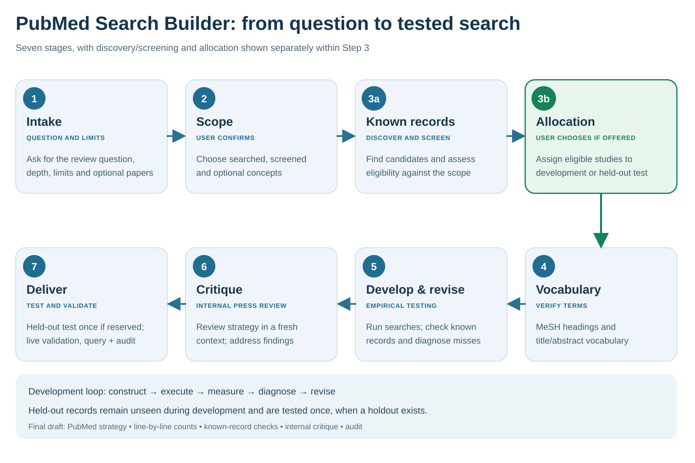
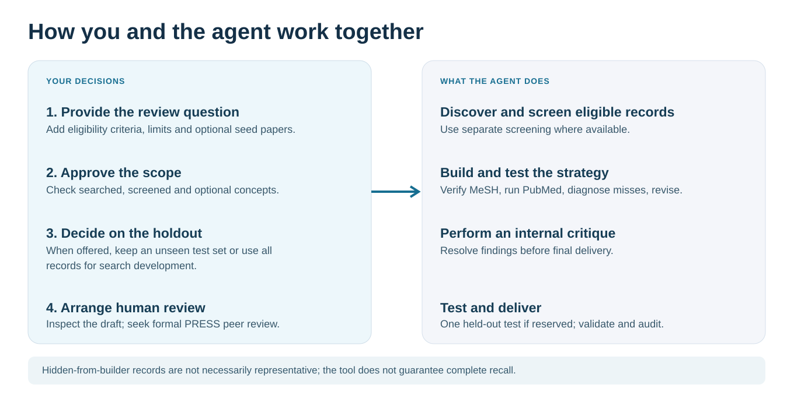

# PubMed Search Builder (next)

**Develop, test and document high-sensitivity PubMed search strategies with an AI coding agent.**

> **Preview branch:** The skill is named `pubmed-search-builder-holdout-verbose` in `SKILL.md`. This branch introduces private candidate screening, development/held-out allocation, one final held-out retrieval test when feasible, and optional verbose progress messages.

PubMed Search Builder is an agent skill for **Codex and Claude Code**. Give it a systematic, scoping or rapid review question and, optionally, papers already known to be relevant. It develops a PubMed strategy, **executes candidate queries against PubMed**, checks their interpretation and results, examines which relevant records were missed, and revises the search. It then conducts a PRESS-structured *internal* critique and delivers a validated query with an audit trail.

**Why not just ask an LLM for a Boolean string?** A convincing-looking search can contain non-existent MeSH headings, over-restrictive AND blocks, unsuitable field tags or PubMed translations that differ from the intended search. This workflow tests the search against PubMed and records what happened; it does **not** establish that every relevant paper was found.



## Quick start

You need **Python 3.10+**, internet access to NCBI E-utilities, and **Codex or Claude Code**. No additional Python packages are required for the core search tool.

1. Clone or download **this branch** and open the repository in your coding agent.
2. Copy `.env.example` to `.env`, then set `NCBI_EMAIL=your.email@example.com`. An `NCBI_API_KEY` is optional. Do not commit `.env`.
3. Ask the agent to read and follow `SKILL.md`, and supply your review question.

For example, send this to your agent:

> Read `SKILL.md` in this repository and build a high-sensitivity PubMed search for a systematic review of school-based food and nutrition education interventions and adolescent food consumption.

The agent runs the commands; **you do not need to operate the CLI yourself**. During intake, it asks for any **known relevant papers** (PMIDs, DOIs or PMCIDs; optional), your preferred **depth** (quick, standard or thorough), any required **date or language limits**, and whether you want **standard or verbose progress messages**. You do not need to specify these in the opening prompt. The agent also asks you to approve or revise the proposed search scope before building the strategy. You can provide inclusion/exclusion criteria at intake. The workflow supports reviewing or updating an existing strategy too.

To check local configuration:

```bash
cp .env.example .env
# Edit .env to set NCBI_EMAIL.
python scripts/psb.py doctor
```

**Important:** A clone of this branch does not automatically install the skill globally in your coding agent. The straightforward route is to open the repository and explicitly ask the agent to follow its `SKILL.md`. The skill is designed for a coding agent with terminal and network access, not the ordinary ChatGPT or Claude web chat.

## Example: from a review question to a tested strategy

Consider: **“Do school-based food and nutrition education interventions change food consumption among adolescents?”**

The workflow does not immediately concatenate every element of this question with AND. It first proposes concept roles for your approval. For example, an agent might propose a **school-based intervention** concept and a **food/nutrition education** concept for searching, while leaving **food consumption outcomes** for screening if they are inconsistently mentioned in abstracts. This is *illustrative*, not a tested strategy or a recommendation to omit the adolescent population: the actual scope decision depends on the eligibility criteria and must be confirmed.

After scope approval, it identifies MeSH and title/abstract terms, runs the candidate search in PubMed and checks known relevant records when available. If a relevant paper is missed, it can identify which required concept block prevented its retrieval, inspect the terminology used in that paper, revise the search and test again. It then completes the internal critique and runs live validation before delivery.

**What a complete run can show:**

- The scope table, including concepts deliberately left to screening rather than AND-ed into the query.
- An executable PubMed query and its line-by-line result counts.
- Which *development* records the query retrieved or missed, and which blocks contributed to misses.
- The successive revisions, decisions and unresolved limitations.
- A held-out retrieval result **only if** eligible unexposed records were reserved and a separate test was completed.
- A PRESS-structured internal critique and a PRISMA-S-style PubMed audit.

**This example is a walkthrough of the implemented workflow, not an empirical case report.** No query, record count or improvement is claimed for this review question here. A real end-to-end worked case with archived outputs should be added separately rather than inventing before/after performance numbers.

## How the seven-step workflow works

| Step | What happens | Your involvement |
|---|---|---|
| **1. Intake** | Record the question, known papers, depth and required limits. | Supply the question and any constraints. |
| **2. Scope** | Decide which concepts become searched blocks, which are checked during screening, and which are optional. | **Approve or revise** the concept roles before search construction. |
| **3. Known records** | Find and screen candidate records through prior reviews, narrow pilots and related/citing records; allocate eligible records. | Choose whether to keep a proposed held-out set or use all records for development. |
| **4. Vocabulary** | Verify MeSH headings and select free-text variants for each searched concept. | Usually no action needed. |
| **5. Develop and revise** | Execute PubMed queries, inspect counts/translations, check development records, diagnose misses and revise. | Review search decisions as needed. |
| **6. Critique** | Run a fresh-context, PRESS-structured internal critique; address findings. | Review unresolved decisions if necessary. |
| **7. Validate and deliver** | Test a frozen query once on held-out records when reserved, revalidate the query live, and generate protected outputs. | Review the results; arrange human PRESS peer review where appropriate. |

**The essential loop:** construct → execute → measure → diagnose → revise. A final draft is delivered only if the required checks pass. If the held-out test reveals a miss, the tested query is reported **unchanged** first; a subsequent repair is explicitly labelled as no longer independently tested against those records.



## What progress looks like

The tool generates consistent messages for each of the seven stages. For instance, the stage headings include `PSB · Step 2/7 Scope`, `PSB · Step 3/7 Known records`, and `PSB · Step 5/7 Develop & revise`. The messages identify what has happened and what comes next.

Choose **standard** messages for short updates or **verbose** messages for up to three additional detail lines on discovery, MeSH lookups, term mining and evaluation. Verbose mode changes what is *shown*, **not** what is searched or screened. Private screening messages never disclose their hidden records or queries, even in verbose mode. See [the progress-message specification](references/verbose.md) and [example messages from a synthetic test corpus](tests/golden/progress_sequence.md).

## Choose a search depth

| Depth | Candidate-screening budget | Internal critique | Held-out test |
|---|---:|---|---|
| **Quick** | Up to about 30 | 1 revision round, then closing | No automatic holdout |
| **Standard (default)** | Up to about 150 | 2 revision rounds, then closing | Proposed if eligible, unexposed records exist and allocation conditions are met |
| **Thorough** | Up to about 400 | 3 revision rounds, then closing | Same conditional allocation as standard |

These are **upper screening budgets**, not promises of how many eligible studies will be found or guarantees of greater recall. Further verification/closing rounds can be required by the critique rules. See [SKILL.md](SKILL.md).

## Development records versus held-out records

A search that retrieves papers already used to build it has passed a **development check**, not an independent test. This branch can use a separate agent context to discover and screen records without revealing their titles, abstracts, search queries or screening decisions to the search-building agent. Eligible records are then allocated:

- **Development records** can be inspected for terminology, used to diagnose missed records, and checked repeatedly during revisions.
- **Held-out records** remain unavailable to the builder and are checked **once** against the frozen final query, when a holdout is feasible and chosen.
- **Comparison lists** are reported separately; they are not treated as independent held-out tests.

An automatic holdout is proposed only when at least **10 eligible allocation units** exist and at least one is unexposed. It reserves approximately 30% of eligible units, capped by the unexposed units available, while keeping reports of the same study together where recognised. You can instead choose all-development allocation. A private, unexposed context is a **procedural safeguard**, not an access-control security boundary; without such a context, all records are development records.

**A held-out result is not a reliable estimate of overall recall by itself.** The pool may overrepresent papers similar to the queries, prior reviews or seed studies used to assemble it. Finding 6 of 6 held-out records establishes retrieval of those six records, not that the strategy retrieves nearly all eligible literature. The number of independent studies, study grouping and discovery sources matter as well. See [known-record methods](references/known-records.md) and [fixed interpretation rules](references/reporting.md).

## What you receive

When the delivery gate passes, the workspace contains:

| Output | What it contains |
|---|---|
| `final-query.txt` | The copyable, revalidated PubMed strategy |
| `audit.md` | Scope, search lines and counts, record-based checks, development history, critic findings, limitations and PubMed reporting details |
| `validation-manifest.json` | Evidence that the delivered artefacts correspond to the evaluated and validated query |

The final query is a **draft for human PRESS peer review by an information specialist**, not a formally peer-reviewed strategy. The audit follows relevant [PRISMA-S](https://doi.org/10.1186/s13643-020-01542-z) reporting principles for **PubMed only**; it is not a complete multi-database PRISMA-S report. See [reporting details](references/reporting.md).

## Evaluation: what is and is not established

The repository contains an [end-to-end evaluation harness](evals/README.md), [historical results](evals/RESULTS.md), development topics and separately frozen held-out **topics**. These topic-level held-out evaluations assess changes to the skill; they are **different** from the record-level held-out test within one user's search build.

**Version caveat:** `evals/RESULTS.md` was generated on **30 September 2026** and contains results from earlier staged skill versions. It must not be read as an end-to-end performance evaluation of the exact current `pubmed-clearerui` branch, which has introduced substantial subsequent changes. The repository also includes targeted automated tests of allocation, private disclosure, held-out receipts, progress messages and delivery checks; those tests establish intended software behaviour under test conditions, **not improved real-world retrieval recall**.

The historical evaluation covers recall against known published-review reference sets, unseen recall, search size and workload proxies. Comparisons must consider variation across repeated agent runs, uneven run completion and how much larger a result set becomes in exchange for higher recall. See the [evaluation methods](evals/README.md) before citing results.

## Limitations

- **No guarantee of complete recall.** Evaluation is against available reference records, not an exhaustive census of every eligible study.
- **Discovery bias remains possible.** A held-out set can be unseen yet unrepresentative of the literature.
- **Eligibility screening is fallible.** Agent screening and study-group identifiers need appropriate human checking; different identifiers for the same study are not automatically reconciled.
- **Full-text extraction is not built into `psb`.** When included-study tables or supplementary files from earlier reviews are required, an agent needs other permitted tools or user-supplied documents.
- **Recall-first searches can be large.** Additional retrieved records impose real screening workload.
- **Internal critique is not independent human PRESS peer review.**
- **Only PubMed/MEDLINE is covered.** Other databases, registers, citation searches and grey-literature searches need separate planning.

## For developers and auditors

Most users can stop here. The technical material is in:

- [`SKILL.md`](SKILL.md) — instructions followed by Codex or Claude Code.
- [Known-record discovery and allocation](references/known-records.md) — origins, exposure, screening, allocation and repair.
- [Scope and concept decisions](references/scope.md) — searched versus screened concepts.
- [Validation and phrase-warning handling](references/validation.md) — PubMed syntax and delivery blockers.
- [Reporting and protected outputs](references/reporting.md) — interpretation language and audit structure.
- [Progress messages](references/verbose.md) — verbose mode behaviour.
- [Evaluation harness](evals/README.md) and [results](evals/RESULTS.md).
- [Allocation implementation plan](ALLOCATION_PLAN.md) — historical design rationale, not the primary user instructions.

**CLI commands:** `python scripts/psb.py --workspace <run-dir> <command> ...`. Start with `python scripts/psb.py doctor` and `SKILL.md`; do not manually bypass the agent's required allocation, critique and reporting checks.

**Automated tests:**

```bash
uv run --with pytest python -m pytest
# Optional live NCBI smoke test:
PSB_LIVE_TESTS=1 python -m pytest tests/test_guardrails.py -q
```

## Licence

MIT
